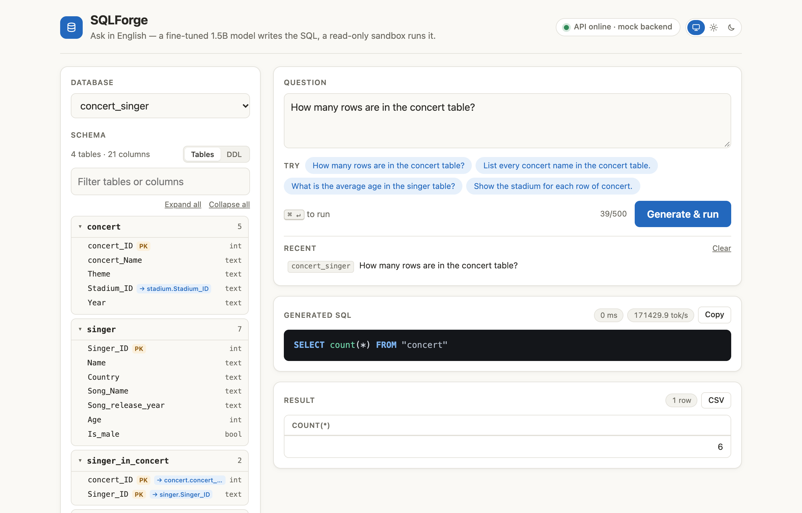
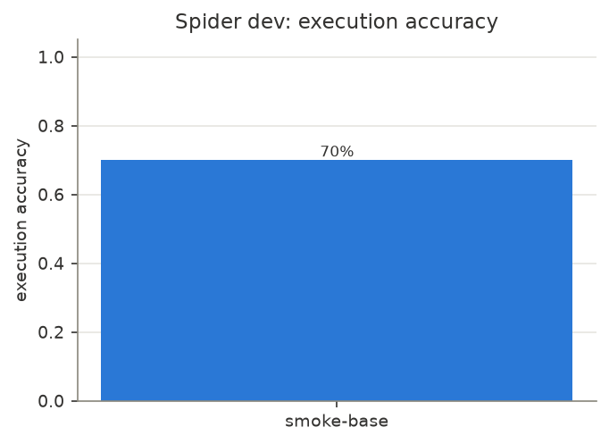
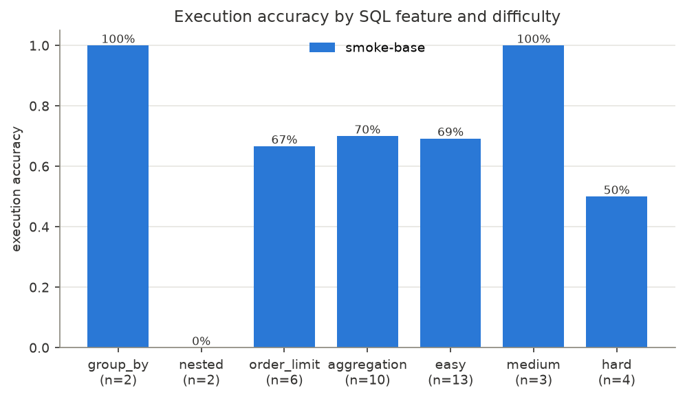
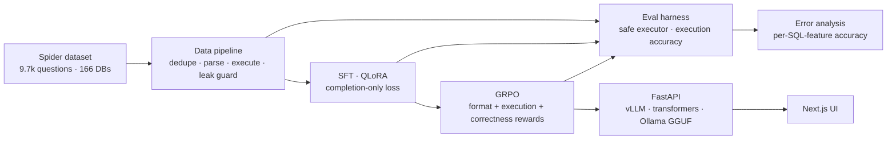

# SQLForge

**Teaching a 1.5B-parameter LLM to write correct SQL — supervised fine-tuning, then
reinforcement learning against real query execution (GRPO), all on free-tier compute.**

Ask a question in plain English, get a SQLite query that actually runs and returns the
right rows. Every stage is measured by **execution accuracy** on the Spider dev set,
through an eval harness built *before* any training.


*The web UI on the mock backend (`docker compose up`, then http://localhost:3000). The
mock always answers with a row count of the first table, so its latency and tok/s are
meaningless; set `SQLFORGE_BACKEND` to serve the real model.*

## Results

| Model | Execution accuracy | Exact match |
|---|---|---|
| Qwen2.5-Coder-1.5B-Instruct (base) | _run notebook 01_ | – |
| + SFT (QLoRA, 2 epochs) | _run notebook 02_ | – |
| + GRPO (execution rewards) | _run notebook 03_ | – |

> Full table, per-category breakdowns and charts land in
> [docs/results.md](docs/results.md) as the Colab runs complete. Local smoke test
> (first 20 dev examples, MPS): base model 70% execution accuracy — the harness is
> verified end to end; full-set numbers will be lower.




## Architecture



**The core loop:** the same safe SQL executor (read-only, parse-validated,
timeout-bounded) is the data-quality filter, the eval metric, the GRPO reward, and the
serving sandbox. One component, four jobs, tested once.

## Web UI

A Next.js page over the API (`web/`). The sidebar browses the selected database's
schema — tables, column types, primary keys, and foreign keys that jump to the table
they reference — with a filter and a DDL tab showing exactly the text the model is
prompted with. Example questions are generated from that schema, a counter enforces
the API's 500-character cap, and recent questions are kept per browser. Results show
the highlighted SQL with latency, the rows (long values clipped, full text on hover)
and a CSV download that guards against spreadsheet formula injection. It follows the
system light/dark setting or a manual toggle, meets WCAG AA contrast, announces
progress to screen readers, and works at phone width.

## Reproduce it

Everything is scripted; GPU steps run on a **free Colab T4** via the thin notebooks in
`notebooks/` (set `REPO_URL` in the first cell).

```bash
# Local setup (uv: https://docs.astral.sh/uv/)
uv sync                                     # light core (no torch)
uv run pytest                               # 74 tests, all offline
uv run python scripts/download_spider.py    # 205MB official spider_data.zip
uv run python scripts/build_dataset.py      # filters + splits -> data/processed/

# Eval smoke test on CPU/MPS (downloads the 1.5B model)
uv sync --group ml
uv run python scripts/run_eval.py --name smoke --limit 20 --batch-size 4
```

| Step | Where | How |
|---|---|---|
| 1. Baseline eval | Colab T4 | `notebooks/01_baseline_eval.ipynb` (~40 min) |
| 2. SFT | Colab T4 | `notebooks/02_sft.ipynb` (~2 h, resumable) |
| 3. GRPO | Colab T4 | `notebooks/03_grpo.ipynb` (2–3 sessions, resumable) |
| 4. Error analysis | anywhere | `scripts/analyze_errors.py base=... sft=... grpo=...` |
| 5. Serve + UI | anywhere | `docker compose up` (mock backend by default) |
| 6. Latency bench | anywhere | `scripts/benchmark_latency.py --log-results` |

To serve the real model locally on CPU: `scripts/merge_adapter.py`, convert to GGUF
Q8_0 with llama.cpp, `ollama create sqlforge`, then `SQLFORGE_BACKEND=ollama` — the
full recipe is in [docs/decisions.md](docs/decisions.md).

## Repo layout

```
configs/        yaml per stage (data, sft, grpo, serve) — SQLFORGE_* env overrides
src/sqlforge/   config, seeding, safe executor, data pipeline, eval, analysis, serving
training/       sft.py, grpo.py, rewards.py (unit-tested reward components)
scripts/        download, build_dataset, run_eval, analyze_errors, inspect_outputs,
                merge_adapter, benchmark_latency
notebooks/      thin Colab wrappers (01 baseline, 02 SFT, 03 GRPO)
tests/          74 offline tests with tiny fixtures
docs/           decisions.md · results.md · failures.md · grpo-explained.md · assets/
web/            Next.js + TypeScript frontend
```

## Design docs

- [docs/decisions.md](docs/decisions.md) — every non-obvious choice, with alternatives
- [docs/grpo-explained.md](docs/grpo-explained.md) — GRPO vs PPO vs DPO, and the catch
- [docs/results.md](docs/results.md) — append-only metrics log
- [docs/failures.md](docs/failures.md) — what broke, incl. reward-hacking inspection
- [docs/interview-qa.md](docs/interview-qa.md) — 10 questions this project should
  prepare you to answer

## Limitations and future work

- **Execution accuracy has false positives**: a wrong query can return the right rows
  on a particular database state (e.g. missing ORDER BY on already-sorted data). Fix:
  test-suite evaluation over multiple database variants (Zhong et al.).
- **Single-dialect**: SQLite only. Spider 2.0 / BIRD (messier schemas, external
  knowledge) are the natural next benchmark.
- **Full-schema prompts**: no schema linking; very large schemas fall back to a lossy
  compact format. A retrieval step over tables would scale past Spider-sized DBs.
- **GRPO scale**: 2000 prompts × 8 samples on one T4; more prompts, larger groups, or
  a 7B base would likely widen the RL gain.
- **Rate limiting is in-memory per process** — swap for Redis behind a real LB.
