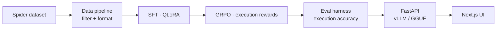

# SQLForge

**Teaching a 1.5B-parameter LLM to write correct SQL — with supervised fine-tuning, then
reinforcement learning against real query execution (GRPO), on free-tier compute.**

Ask a question in plain English, get a SQLite query that actually runs and returns the
right rows. Base model → SFT → GRPO, each step measured by execution accuracy on the
Spider dev set.

> 🚧 Work in progress — milestones below are checked off as they land.

## Results

| Model | Execution accuracy | Exact match |
|---|---|---|
| Qwen2.5-Coder-1.5B-Instruct (base) | – | – |
| + SFT (QLoRA) | – | – |
| + GRPO | – | – |

*(Filled in as milestones 2–4 complete. Full details in [docs/results.md](docs/results.md).)*

## Architecture



## Milestones

- [x] 0 — Project setup (uv, ruff, pytest, config loader, seeding)
- [ ] 1 — Data pipeline (Spider download, prompt template, quality filters, leak-safe splits)
- [ ] 2 — Eval harness + baseline (safe SQL executor, execution accuracy)
- [ ] 3 — SFT with QLoRA on a free Colab T4
- [ ] 4 — GRPO with unit-tested execution rewards
- [ ] 5 — Error analysis (per-SQL-feature accuracy, charts)
- [ ] 6 — Serving (FastAPI, vLLM/GGUF, Docker, latency benchmark)
- [ ] 7 — Next.js frontend
- [ ] 8 — Docs and polish

## Quick start

```bash
# Requires uv (https://docs.astral.sh/uv/)
uv sync
uv run pytest
uv run ruff check .
```

Copy `.env.example` to `.env` and fill in tokens before any milestone that downloads
models or logs to W&B.

## Repo layout

```
configs/        yaml configs per stage
src/sqlforge/   package: config, seeding, data, eval, serving
training/       sft.py, grpo.py, rewards.py
scripts/        dataset download, eval runner, benchmarks
notebooks/      thin Colab wrappers around the scripts
tests/          pytest with tiny offline fixtures
docs/           decisions.md, results.md, failures.md, charts
web/            Next.js frontend
```

## Docs

- [Decisions](docs/decisions.md) — why each non-obvious choice was made
- [Results](docs/results.md) — all metrics, appended chronologically
- [Failures](docs/failures.md) — what went wrong, including reward hacking finds
