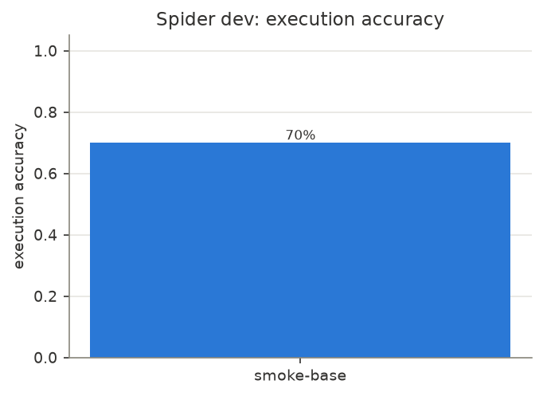
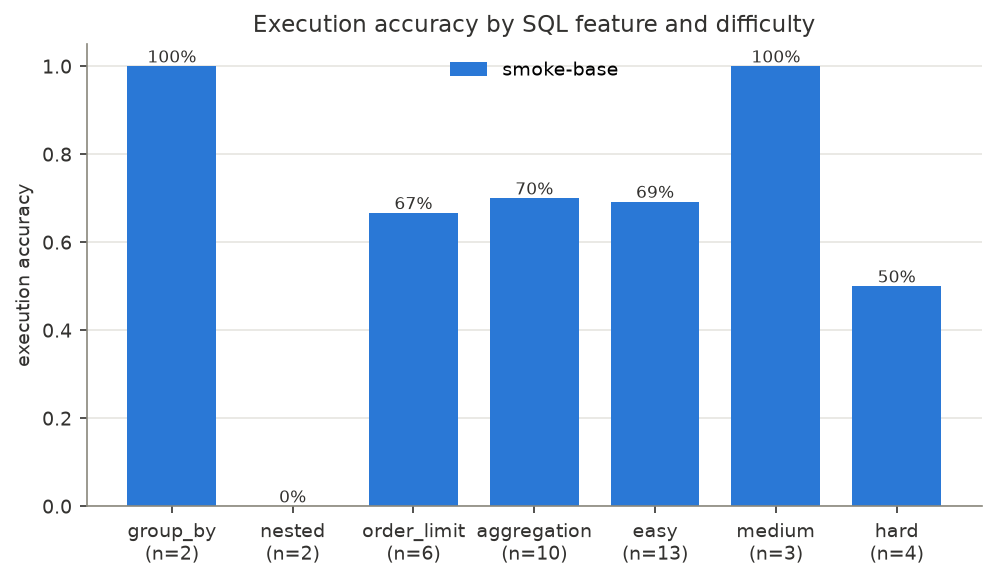

# Results

All metrics land here, appended with date and commit hash. Never overwritten.

## 2026-10-27 — Data pipeline (commit 606fe3f)

- Input: 8659 train / 1034 test examples
- Dropped: train/dedupe: 24, train/executes: 3
- Output: **8632 train / 1034 test**
- Databases: 146 train, 20 test (overlap enforced to be zero)

## 2026-10-27 — Eval `smoke-base` (commit 0dbf749)

- Model: `Qwen/Qwen2.5-Coder-1.5B-Instruct`
- Examples: 20 — **execution accuracy 70.0%**, exact match 60.0%, pred errors 20.0%

## 2026-10-27 — Error analysis (smoke-base)

| Category | n | smoke-base |
|---|---|---|
| overall | 20 | 70.0% |
| group_by | 2 | 100.0% |
| nested | 2 | 0.0% |
| order_limit | 6 | 66.7% |
| aggregation | 10 | 70.0% |
| difficulty/easy | 13 | 69.2% |
| difficulty/medium | 3 | 100.0% |
| difficulty/hard | 4 | 50.0% |

